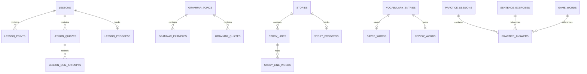

# Bubixo Flutter — Yerel SQLite / Drift Veritabanı Tasarımı

**Durum:** Analiz ve şema tasarımı  
**İncelenen dal:** `feature/practice-first-navigation`  
**Şema sürümü önerisi:** v1  
**Kapsam:** Uygulama içeriği, kelimeler, ders/hikâye ilerlemesi, pratik oturumları ve mevcut yerel verilerin göçü

Bu belge veritabanı tasarım kararını ve uygulanacak şemayı tanımlar. Veritabanının henüz uygulamaya eklendiği veya mevcut kullanıcı verilerinin taşındığı anlamına gelmez.

---

## 1. Önemli teknoloji kararı: SQLite, sqflite ve Drift aynı şey değil

- **SQLite** verinin saklandığı veritabanı motorudur.
- **sqflite** Flutter/Dart tarafından SQLite'a erişmek için kullanılan bir API/eklenti katmanıdır.
- **Drift** SQLite üzerinde tip güvenli sorgular, ilişkiler, transaction yönetimi, değişiklik akışları ve şema göçleri sağlayan veri erişim katmanıdır. Drift, sqflite tabanlı bir executor ile de çalışabilir.

Bu projeye hem ham sqflite sorguları hem Drift sorguları ekleyerek iki ayrı veri erişim yöntemi kullanmak önerilmiyor. Aynı tabloların iki farklı API üzerinden yönetilmesi kuralları ve testleri bölerek bakım yükünü artırır.

### Bu projeye önerim

**Drift + SQLite, tek uygulama veri erişim API'si.**

Depoda iOS ve Android yanında macOS, Windows, Linux ve Web hedefleri de var; CI'da widget testleri de çalışıyor. Drift'in güncel platform belgesi, `drift_sqflite` executor'ünü Android/iOS ile sınırlandırıyor ve Flutter testlerinde desteklenmediğini belirtiyor. Yeni uygulamalarda FFI tabanlı `NativeDatabase` öneriliyor. Web desteği gerekiyorsa Web için ayrı Drift executor/bağlantısı kullanılmalı.

Kaynaklar:
- Drift platform seçimi: https://drift.simonbinder.eu/platforms/
- Drift ve sqflite karşılaştırması: https://drift.simonbinder.eu/faq/
- Drift özelliği ve yaklaşımı: https://drift.simonbinder.eu/
- sqflite paketi: https://pub.dev/packages/sqflite

**Karar:** Şema ve repository'ler Drift üzerinde tasarlanacak. Platforma özel bağlantı tek bir factory/connection dosyasında soyutlanacak. Yalnızca hedef platformları iOS/Android'e daraltma kararı alınırsa `drift_sqflite` ayrıca yeniden değerlendirilebilir.

---

## 2. Mevcut projenin bulguları

### 2.1 Şu anda yerel veritabanı yok

`pubspec.yaml` içinde Drift veya sqflite bağımlılığı bulunmuyor. İçerik JSON asset'lerinden okunuyor; kullanıcı durumu `SharedPreferences` anahtarlarıyla saklanıyor. `lib/features/learn/data/learning_progress_repository.dart` bir veritabanı repository'si değil, `SharedPreferences` sarmalayıcısı.

### 2.2 İçerik envanteri

JSON asset'lerinin tüm kayıtları ve üst seviye alanları analiz edildi:

| İçerik | Kayıt | İç içe kayıtlar / önemli alanlar | Kimlik durumu |
|---|---:|---|---|
| `lessons.json` | 10 ders | 86 ders noktası, 50 quiz, 200 quiz seçeneği | `u1…u10` mevcut |
| `words.json` | 3.000 kelime/ifade | `english`, `turkish`, isteğe bağlı `emoji` (3 kayıtta var) | Kaynak ID yok; İngilizce alanları şu an benzersiz |
| `grammar.json` | 6 konu | 29 örnek, 18 quiz, 72 quiz seçeneği | `g1…g6` mevcut |
| `stories.json` | 12 hikâye | 129 satır, 796 satır-kelime eşlemesi; seviye 1–3 | `s1…s12` mevcut |
| `sentence_builder.json` | 120 alıştırma | kategori, seviye, Türkçe/İngilizce cümle, not, çeldiriciler | Kaynak ID yok |
| `game_words.json` | 240 kelime | 12 tema; İngilizce/Türkçe/tema | Kaynak ID yok |

Kaynak dosyalar uygulamada kalmaya devam edecek; veritabanı ilk kurulumda bunlarla doldurulacak. JSON dosyaları içerik için sürümlenebilir, gözden geçirilebilir kaynak olarak kalacak. Böylece ilk açılışta internet gerektirmeyen içerik ve DB üzerinden arama/ilişki sorguları birlikte sağlanır.

### 2.3 Kullanıcı durumunun şu anki anahtarları

Kodda doğrulanan kalıcı anahtarlar:

| Anahtar | Şu anki veri | Tasarımda karşılığı |
|---|---|---|
| `bubixo.saved_words` | Kaydedilen İngilizce metinler listesi | `saved_words` + `vocabulary_entries` |
| `bubixo.review_words` | Tekrar listesi için İngilizce metinler | `review_words` |
| `bubixo.custom_words` | JSON metninde İngilizce/Türkçe/tür | `vocabulary_entries` içinde kullanıcı/öykü kaynaklı girdiler |
| `bubixo.read_story_ids` | Açılan hikâyelerin ID listesi | `story_progress` durumunu en azından `started` olarak aktar |
| `bubixo.last_story_id`, `bubixo.last_story_title` | Son hikâye | `story_progress.last_read_at` ve son etkinlik state'i |
| `bubixo.learning.completed_lessons` | Tamamlanan ders ID'leri listesi | `lesson_progress` |
| `bubixo.learning.last_lesson_id` | Son ders ID'si | `lesson_progress.last_opened_at` + etkinlik state'i |
| `bubixo.learning.quiz_attempts`, `bubixo.learning.quiz_correct` | Ders quiz'leri için toplam sayaçlar | `learning_stats` toplamları; yeni denemeler ayrıca detay tablosuna |
| `bubixo.practice.sessions`, `bubixo.practice.correct_answers` | Pratik toplamları | `learning_stats` + yeni `practice_sessions` kayıtları |
| `bubixo.last_activity_type`, `bubixo.last_activity_id` | Son etkinlik bilgisi | `app_state` |

### 2.4 Mevcut veri tutarsızlıkları / kayıp riski

1. Hikâye ID'si, okuyucu açılmadan hemen önce `read_story_ids` içine ekleniyor. Yani mevcut sayaç “tamamlanmış hikâye” değil, daha doğru ifadeyle “açılmış hikâye” sayısını gösteriyor. Göç sırasında bu kayıtları yanlışlıkla tamamlandı kabul etmeyeceğiz.
2. Kaydedilen kelimeler tek başına İngilizce metin olarak; özel kelime/çeviri kayıtları ise ayrı JSON metni olarak saklanıyor. Bu iki liste arasında ilişkisel bütünlük yok.
3. Pratik ekranı sadece oturum tamamlandığında toplam oturum ve doğru cevap sayısını artırıyor; soru bazında geçmiş saklamıyor.
4. Ders quiz sayaçları toplam olarak tutuluyor, hangi sorunun hangi cevabının verildiği tutulmuyor.
5. Birkaç `SharedPreferences` yazımı ayrı ayrı yapılıyor. Birbirine bağlı çoklu değişikliklerde SQLite transaction'ı kadar güçlü atomiklik sağlamıyor.

Bu durumların hepsini bir kerede kullanıcı arayüzünü yeniden yazmadan düzeltmek zorunda değiliz. Önce veritabanı ve göç katmanı kurulmalı, sonra ekranlar repository'lere kademeli olarak geçirilmeli.

---

## 3. Veri sahipliği ve kurallar

1. **Asset JSON = içerik kaynak dosyası.** İçerik düzenlemek/incelemek için kaynak olarak kalır.
2. **SQLite = uygulamanın runtime içerik deposu + kullanıcı durumu.** Kelimeler aranır, içerik ilişkileri sorgulanır ve ilerleme kalıcı tutulur.
3. **Drift = tüm DB erişimi.** UI ekranlarında doğrudan SQL, sqflite veya SharedPreferences DB detayları bulunmaz.
4. **Repository'ler** ekranlara tipli sonuç sağlar. Mevcut feature klasörleri korunur; sırf bu iş için domain katmanı eklenmez.
5. İçerik ilk kurulumda transaction içinde yüklenir. Seed yarıda kesilirse yarım içerik bırakılmaz.
6. İçerik seed'i tekrarlanabilir ve idempotent olmalı. Aynı dosyayı ikinci kez yüklemek kullanıcı kayıtlarını çoğaltmamalı.
7. Kullanıcı ilerlemesi, içerik asset'lerinin tekrar yüklenmesi yüzünden silinmemeli. İçerik versiyonları kullanıcı verisinden bağımsız yönetilir.
8. SQLite foreign key kontrolü açılır; ilerleme kayıtları için içerik silme işlemi cascade ile otomatik veri kaybına dönüşmemeli.
9. Uygulama v1'de **hesap/sunucu senkronizasyonu yok**. Bu, cihaz içi veritabanıdır; yeni bir uzak kullanıcı profili tasarlanmıyor.

---

## 4. ER diyagramı



Not: Quiz seçenekleri ve cümle kurma çeldiricileri, v1'de sıralı JSON metni olarak saklanabilir; bunlar tek bir sorunun parçası olarak birlikte yükleniyor, bağımsız arama veya ilişki sorgusu gerektirmiyor. Hikâyedeki kelime eşleştirmeleri ise kullanıcı dokunuşlarıyla ve tekrar kullanılabilir içerik olarak ilişkisel tabloda tutulacak.

---

## 5. Önerilen tablolar

Tarih/saat alanları UTC epoch-millis veya tutarlı bir UTC temsilinde tutulmalı; uygulama katmanı bunu DateTime'a dönüştürmeli. İçerik ID'leri metin olmalı; asset ID'leri korunmalı.

### A. Sabit eğitim içeriği

#### `lessons`
- `id TEXT PRIMARY KEY` — asset'ten gelen `u1…u10`
- `title TEXT NOT NULL`
- `minutes INTEGER NOT NULL`
- `intro TEXT NOT NULL`
- `tip TEXT NOT NULL`
- `is_active INTEGER NOT NULL DEFAULT 1`
- `content_version INTEGER NOT NULL`

#### `lesson_points`
- `id INTEGER PRIMARY KEY AUTOINCREMENT`
- `lesson_id TEXT NOT NULL REFERENCES lessons(id)`
- `position INTEGER NOT NULL`
- `english TEXT NOT NULL`
- `turkish TEXT NOT NULL`
- `UNIQUE(lesson_id, position)`

#### `lesson_quizzes`
- `id TEXT PRIMARY KEY` — kararlı ID: ders ID + quiz konumu
- `lesson_id TEXT NOT NULL REFERENCES lessons(id)`
- `position INTEGER NOT NULL`
- `question TEXT NOT NULL`
- `options_json TEXT NOT NULL`
- `answer_index INTEGER NOT NULL`
- `explanation TEXT NOT NULL`
- `UNIQUE(lesson_id, position)`

#### `grammar_topics`
- `id TEXT PRIMARY KEY` — mevcut `g1…g6`
- `title TEXT NOT NULL`
- `badge TEXT NOT NULL`
- `formula TEXT NOT NULL`
- `explanation TEXT NOT NULL`
- `is_active INTEGER NOT NULL DEFAULT 1`
- `content_version INTEGER NOT NULL`

#### `grammar_examples`
- `id INTEGER PRIMARY KEY AUTOINCREMENT`
- `topic_id TEXT NOT NULL REFERENCES grammar_topics(id)`
- `position INTEGER NOT NULL`
- `english TEXT NOT NULL`
- `turkish TEXT NOT NULL`
- `UNIQUE(topic_id, position)`

#### `grammar_quizzes`
- `id TEXT PRIMARY KEY` — konu ID + quiz konumu
- `topic_id TEXT NOT NULL REFERENCES grammar_topics(id)`
- `position INTEGER NOT NULL`
- `question TEXT NOT NULL`
- `options_json TEXT NOT NULL`
- `answer_index INTEGER NOT NULL`
- `explanation TEXT NOT NULL`
- `UNIQUE(topic_id, position)`

#### `stories`
- `id TEXT PRIMARY KEY` — mevcut `s1…s12`
- `level INTEGER NOT NULL`
- `title TEXT NOT NULL`
- `title_tr TEXT NOT NULL`
- `intro TEXT NOT NULL`
- `is_active INTEGER NOT NULL DEFAULT 1`
- `content_version INTEGER NOT NULL`

#### `story_lines`
- `id INTEGER PRIMARY KEY AUTOINCREMENT`
- `story_id TEXT NOT NULL REFERENCES stories(id)`
- `position INTEGER NOT NULL`
- `english TEXT NOT NULL`
- `turkish TEXT NOT NULL`
- `UNIQUE(story_id, position)`

#### `story_line_words`
- `id INTEGER PRIMARY KEY AUTOINCREMENT`
- `line_id INTEGER NOT NULL REFERENCES story_lines(id)`
- `position INTEGER NOT NULL`
- `english TEXT NOT NULL`
- `turkish TEXT NOT NULL`
- `normalized_english TEXT NOT NULL`
- `normalized_turkish TEXT NOT NULL`
- `UNIQUE(line_id, position)`

#### `vocabulary_entries`
Bu tablo hem 3.000 sözlük girdisini hem hikâyeden veya çeviri ekranından kaydedilen ifadeleri tek bir sözlükte birleştirir.
- `id TEXT PRIMARY KEY` — normalized İngilizce + Türkçe ikilisinden deterministik oluşturulur
- `english TEXT NOT NULL`
- `turkish TEXT NOT NULL DEFAULT ''` — eski kayıt yalnızca İngilizce içeriyorsa çeviri bilinmeyebilir
- `normalized_english TEXT NOT NULL`
- `normalized_turkish TEXT NOT NULL DEFAULT ''`
- `emoji TEXT NULL`
- `kind TEXT NOT NULL DEFAULT 'word'` — ör. word, phrase, story
- `source TEXT NOT NULL` — dictionary, story, manual, legacy
- `created_at INTEGER NULL`
- `UNIQUE(normalized_english, normalized_turkish)`

Normalization yalnızca karşılaştırma/arama anahtarıdır; ekranda gösterilen orijinal Türkçe ve İngilizce metinlerin yerine geçmez. Bir İngilizce sözcüğün ileride birden fazla anlamı olabilmesi nedeniyle yalnızca İngilizce alanına unique kısıtı konulmaz.

#### `sentence_exercises`
- `id TEXT PRIMARY KEY` — içerikten kararlı biçimde türetilir; asset sırasına bağlı rastgele ID kullanılmaz
- `source_position INTEGER NOT NULL` — ilk asset sırasını korur
- `category TEXT NOT NULL`
- `level INTEGER NOT NULL`
- `turkish TEXT NOT NULL`
- `english TEXT NOT NULL`
- `note TEXT NOT NULL`
- `distractors_json TEXT NOT NULL`
- `is_active INTEGER NOT NULL DEFAULT 1`
- `UNIQUE(category, level, english, turkish)`

#### `game_words`
- `id TEXT PRIMARY KEY` — normalize edilmiş kelime çiftinden deterministik
- `source_position INTEGER NOT NULL`
- `english TEXT NOT NULL`
- `turkish TEXT NOT NULL`
- `theme TEXT NOT NULL`
- `is_active INTEGER NOT NULL DEFAULT 1`
- `UNIQUE(english, turkish, theme)`

### B. Kullanıcının kişisel verisi

#### `saved_words`
- `word_id TEXT PRIMARY KEY REFERENCES vocabulary_entries(id)`
- `saved_at INTEGER NOT NULL`

#### `review_words`
- `word_id TEXT PRIMARY KEY REFERENCES vocabulary_entries(id)`
- `added_at INTEGER NOT NULL`
- `last_reviewed_at INTEGER NULL`
- `due_at INTEGER NULL`
- `repetition_count INTEGER NOT NULL DEFAULT 0`

Mevcut uygulama yalnızca “tekrar listesinde mi?” bilgisini tutuyor. `due_at` ve tekrar sayaçları gelecekte aralıklı tekrar algoritmasına geçiş için alan olarak tanımlanabilir; v1'de bir algoritma varmış gibi davranılmamalı.

#### `lesson_progress`
- `lesson_id TEXT PRIMARY KEY REFERENCES lessons(id)`
- `status TEXT NOT NULL` — not_started, in_progress, completed
- `last_quiz_position INTEGER NULL`
- `last_opened_at INTEGER NULL`
- `completed_at INTEGER NULL`

#### `lesson_quiz_attempts`
- `id INTEGER PRIMARY KEY AUTOINCREMENT`
- `lesson_quiz_id TEXT NOT NULL REFERENCES lesson_quizzes(id)`
- `selected_answer_index INTEGER NULL`
- `is_correct INTEGER NOT NULL`
- `answered_at INTEGER NOT NULL`

Yeni quiz cevapları ayrıntılı kaydedilebilir. Eski toplam sayaçlar hangi sorulara ait oldukları bilinmediği için sahte tek tek kayıtlar olarak üretilmeyecek.

#### `story_progress`
- `story_id TEXT PRIMARY KEY REFERENCES stories(id)`
- `status TEXT NOT NULL` — started, completed
- `last_line_position INTEGER NOT NULL DEFAULT 0`
- `started_at INTEGER NULL`
- `last_read_at INTEGER NULL`
- `completed_at INTEGER NULL`

Eski `read_story_ids` değerleri `started` olarak aktarılmalı; gerçek tamamlanma ancak okuyucu akışı bunu doğruladığında işaretlenmeli.

#### `practice_sessions`
- `id INTEGER PRIMARY KEY AUTOINCREMENT`
- `activity_type TEXT NOT NULL` — sentence_builder, word_game, grammar
- `started_at INTEGER NOT NULL`
- `completed_at INTEGER NULL`
- `question_count INTEGER NOT NULL DEFAULT 0`
- `correct_count INTEGER NOT NULL DEFAULT 0`
- `status TEXT NOT NULL` — in_progress, completed, abandoned

#### `practice_answers`
- `id INTEGER PRIMARY KEY AUTOINCREMENT`
- `session_id INTEGER NOT NULL REFERENCES practice_sessions(id)`
- `question_position INTEGER NOT NULL`
- `sentence_exercise_id TEXT NULL REFERENCES sentence_exercises(id)`
- `game_word_id TEXT NULL REFERENCES game_words(id)`
- `selected_answer TEXT NULL`
- `is_correct INTEGER NOT NULL`
- `answered_at INTEGER NOT NULL`

Dil bilgisi cevaplarında `grammar_quiz_id` için ayrıca nullable FK alanı eklenebilir veya cevap türüne özel kayıt tablosu kullanılabilir. Bu implementasyon başlamadan önce seçilmeli; bir satırın birden fazla soru kaynağına aynı anda bağlanmasına izin verilmemeli.

#### `learning_stats`
Eski toplam sayaçları veri kaybetmeden korumak için tek satırlı özet:
- `id INTEGER PRIMARY KEY CHECK (id = 1)`
- `legacy_quiz_attempts INTEGER NOT NULL DEFAULT 0`
- `legacy_quiz_correct INTEGER NOT NULL DEFAULT 0`
- `legacy_practice_sessions INTEGER NOT NULL DEFAULT 0`
- `legacy_practice_correct INTEGER NOT NULL DEFAULT 0`
- `updated_at INTEGER NOT NULL`

İleride yeni event kayıtları ile toplamları birleştiren repository sorguları kullanılabilir. Eski toplamlar, geçmiş olay ayrıntısı bilinmediği için yeni oturum kayıtlarının arasına sahte kayıtlar olarak eklenmemeli.

#### `app_state`
- `key TEXT PRIMARY KEY`
- `value TEXT NOT NULL`
- `updated_at INTEGER NOT NULL`

Yalnızca düşük hacimli genel uygulama durumu için (`last_activity_type`, `last_activity_id` gibi). Kelime listeleri veya quiz geçmişi JSON olarak bu tabloya yığılmamalı.

#### `content_dataset_versions`
- `dataset_key TEXT PRIMARY KEY`
- `version INTEGER NOT NULL`
- `record_count INTEGER NOT NULL`
- `seeded_at INTEGER NOT NULL`

Bu tablo asset dataset'lerinin sürümünü ve ne zaman yüklendiğini kaydeder. Asset içeriği değiştiğinde ilgili dataset versiyonu bilinçli olarak artırılır.

---

## 6. İndeksler ve bütünlük

Başlangıçta şu indeksler gerekir:
- `vocabulary_entries(normalized_english)`
- `vocabulary_entries(normalized_turkish)`
- `stories(level, is_active)`
- `sentence_exercises(level, category, source_position)`
- `game_words(theme, source_position)`
- `lesson_points(lesson_id, position)`
- `lesson_quizzes(lesson_id, position)`
- `story_lines(story_id, position)`
- `story_line_words(line_id, position)`
- `practice_sessions(activity_type, completed_at)`

3.000 kelimelik içerik için ilk sürümde FTS5 zorunlu değil. Başlangıçta normalize edilmiş alanlarda SQL araması ve indeksler kurulmalı; gerçek cihazda arama performansı ölçüldükten sonra tam metin araması (FTS5) gerekip gerekmediğine karar verilmeli.

İlave kurallar:
- SQLite foreign keys etkinleştirilmeli.
- Çoklu seed, kaydetme ve ilerleme güncellemeleri transaction içinde yapılmalı.
- Tüm `position` alanları asset sıralamasını korumalı.
- Cevap indeksi ekleme sırasında seçenek sayısı ile doğrulanmalı.
- Kaynakta ID olmayan içerikler için rastgele UUID her seed'de yeniden üretilmemeli; deterministik ID kullanılmalı.
- Kullanıcı durumu içeriğin seed sürümünden bağımsız kalmalı.

---

## 7. İlk kurulum ve içerik seed akışı

1. Veritabanı açılır ve `schemaVersion = 1` uygulanır.
2. `content_dataset_versions` kontrol edilir.
3. Dataset yoksa veya tanımlı asset sürümü değişmişse JSON asset'leri doğrulanır.
4. İçerik parent tabloları ve child tabloları tek transaction içinde upsert edilir; `position` ile kaynak sırası korunur.
5. Eski içerik satırları kullanıcı ilerlemesine bağlı olabileceği için kontrolsüz biçimde silinmez. Gerekirse `is_active = 0` yapılır.
6. Başarılı seed sonunda versiyon ve kayıt sayıları yazılır.
7. Bir dataset import'u başarısızsa o dataset'in önceki geçerli hali korunur.
8. Uygulama ekranları JSON asset'lerini doğrudan okumak yerine ilgili repository üzerinden veriyi alır.

İlk seed sırasında kayıtlara yalnızca sayısal ID atamak doğru değil; içerik güncellemelerinde ID'ler değişirse kayıtlı kelime ve ilerleme ilişkileri kopabilir.

---

## 8. SharedPreferences → SQLite göçü

Göç tek seferlik ve yeniden çalıştırılsa da veri çoğaltmayan bir süreç olmalı.

1. Eski `SharedPreferences` değerleri okunur.
2. Sözlük ve özel kelimeler seed edildikten sonra `saved_words`/ `review_words` metinleri normalize edilmiş kelime eşleşmeleriyle bağlanır.
3. Hikâye listesi `story_progress` içine `started` olarak aktarılır; otomatik `completed` yapılmaz.
4. `completed_lessons` değerleri `lesson_progress.status = completed` olarak aktarılır.
5. Son ders/hikâye/etkinlik bilgisi ilgili progress satırlarına veya `app_state` içine aktarılır.
6. Quiz ve pratik sayaçları `learning_stats` içine aynen aktarılır.
7. `custom_words` JSON'u doğrulanıp `vocabulary_entries` içine `source = manual/story` ile eklenir.
8. Bütün değişiklikler başarılı olduğunda `app_state` içinde `legacy_preferences_migrated_v1 = true` işaretlenir.
9. Göç doğrulanana kadar eski preference anahtarları otomatik silinmez. Eski verileri silmek ayrı ve açık bir sürüm kararı olur.

Özellikle `custom_words` JSON'u bozuksa uygulama çökmeden anlaşılır bir hata/diagnostic kaydı üretmeli; yanlış veri sessizce tamamlandı sayılmamalı. Göç idempotent olmalı, tekrar çalıştığında iki aynı kelime veya iki progress satırı üretmemeli.

---

## 9. Klasör yapısı önerisi

Feature klasörleri ve mevcut mimari korunarak DB çekirdeği `core` içine konmalı:

```text
lib/
  core/
    database/
      app_database.dart
      database_connection.dart
      database_migrations.dart
      tables/
        lessons_table.dart
        vocabulary_table.dart
        stories_table.dart
        practice_table.dart
        progress_table.dart
      daos/
        content_dao.dart
        vocabulary_dao.dart
        progress_dao.dart
        practice_dao.dart
      seed/
        content_seeder.dart
        legacy_preferences_migrator.dart
  features/
    learn/data/
      lesson_repository.dart
      learning_progress_repository.dart
    words/data/
      vocabulary_repository.dart
    discover/data/
      story_repository.dart
    practice/data/
      practice_data_repository.dart
```

Drift'in generated dosyaları commit stratejisine göre build_runner ile üretilecek. DAO/repository'ler ekranların ihtiyaç duyduğu sorguları sağlar. Mevcut ekranlar doğrudan bir kerede değiştirilmek yerine feature feature taşınmalı.

---

## 10. Aşamalı uygulama planı

### DB-1 — Altyapı ve şema
- [ ] Drift ve codegen bağımlılıklarını SDK ile uyumlu şekilde ekle.
- [ ] Native ve Web bağlantı seçeneklerini tek bağlantı factory'sinde ayır.
- [ ] Tablolar, foreign key'ler, indeksler ve `schemaVersion` tanımla.
- [ ] İlk şema için migration testi ekle.
- [ ] In-memory DB ile unit test kur.

### DB-2 — İçerik import'u
- [ ] Altı asset'i typed importer ile yükle.
- [ ] Kararlı ID ve `position` üretimini test et.
- [ ] Seed'i transaction + dataset version kontrolüyle çalıştır.
- [ ] Kaynak/hedef kayıt sayılarını ve örnek eşleşmeleri doğrula.

### DB-3 — Mevcut ekranları taşıma
- [ ] Kelime arama/kaydetme/tekrar akışını DB repository'sine bağla.
- [ ] Story reader ve story progress'i DB'ye bağla.
- [ ] Lesson progress ve quiz sonuçlarını DB'ye bağla.
- [ ] Practice oturumları ve sonuçlarını DB'ye bağla.
- [ ] Ekranların loading/error/empty state'lerini ve geri gezinmesini koru.

### DB-4 — Legacy göç ve doğrulama
- [ ] SharedPreferences göçünü idempotent yap.
- [ ] Göç önce/sonrası sayaç ve kelime sayısını test et.
- [ ] App kill/relaunch sonrasında progress'in korunduğunu doğrula.
- [ ] Şema v1 → v2 migration testi örneği eklemeden v1'i yayımlanabilir kabul etme.
- [ ] `flutter analyze`, `flutter test` ve iOS simulator temel akışlarını çalıştır.

---

## 11. Tamamlanma ölçütleri

DB altyapısı aşağıdaki koşullar doğrulanmadan “tamamlandı” sayılmamalı:
- Tüm içerik tabloları asset verileriyle transaction içinde dolduruluyor.
- İkinci seed aynı verileri çoğaltmıyor ve kullanıcı ilerlemesini silmiyor.
- Foreign key ve unique constraint testleri geçiyor.
- SharedPreferences göçü başarısız olursa tekrar denenebiliyor.
- Kaydedilen kelime, hikâye/ders ilerlemesi ve pratik sayaçları uygulama yeniden açıldığında korunuyor.
- İçerik tablosu ve kişisel ilerleme tabloları birbirinden bağımsız güncellenebiliyor.
- CI'da analiz, testler ve migration testleri başarılı.
- Uygulama arayüzü sadece repository'lerle veri okuyor/yazıyor; DB kodu widget'lara sızmıyor.

**Sonuç:** Önce Drift şeması ve seed/migration altyapısı kurulmalı; sonra kelime kaydetme ile ilerleme verisi ilk taşınacak alanlar olmalı. Dersler ve hikâyelerin JSON'dan runtime DB'ye geçişi bundan sonra, testlerle birlikte yapılmalı.
